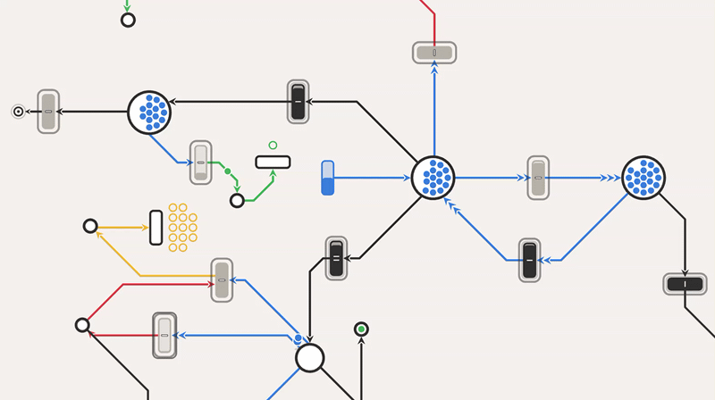

# Mini Petri

A small Mini Metro-style browser and smartphone game built on colored Petri nets (TypeScript + PixiJS v8).

[](https://benkeks.github.io/mini-petri/)

## How to play

Route colored deliveries from sources to matching goals (sinks).
Circles hold box-shaped deliveries; bars are transitions; colored lines show which deliveries a connection moves.
Empty boxes beside a goal show what it still needs.
Filled goals disappear, and your score counts matching deliveries.
New sources and goals appear as epochs advance, introducing new colors and delivery combinations.

**Tap a dark transition to fire it**, consuming its inputs and sending deliveries onward.
Grey transitions are blocked: they need the right deliveries, connected ports and room at their destinations.
The initial relay passes deliveries through unchanged; sources and sinks fire automatically.
Place sizes indicate capacities of 1, 7 or 19 deliveries.
The starting blue source is unlimited until epoch 2000, when it gains a remaining supply of 50 and a warning.
Its output place holds 19 deliveries and the destination after the relay holds 7.
Finite sources show their remaining supply beside them.
Later goals may require colors you must produce with special transitions rather than collect from a matching source.
Late epochs add paired and four-color goals, persistent infinite sinks that can still starve, and multiple sinks per epoch.
Overlapping colored goal boxes represent the deliveries needed together for one firing.

Drag empty space to pan; use the mouse wheel, trackpad or a two-finger pinch to zoom.
Leave placement mode before dragging.
The upper left shows the delivery count, game time and epoch.
Colored boxes appear as new delivery colors unlock and jump when a matching delivery scores.
**Pause** freezes gameplay; **Restart** asks for confirmation before starting a fresh run.
Supported smartphones also offer a fullscreen button.

### Building and upgrades

Use the bottom toolbar; tap the selected tool again or press Escape to return to firing.
Hold to preview a build, drag to adjust it, and release at a valid position to commit.
Previews show the node's colored connectors and proposed arcs, without moving the camera.
Release outside the play area or press Escape to cancel.
Selecting the starting node again or releasing far beyond the build range also cancels.
Successful builds and upgrades return to the default tool; removal stays active.

- **Connect:** tap a loose plug and a place in either order.
  Alternatively, drag from a plug or place to the other endpoint; drag into empty space to build a connected place or relay.
  With a plug selected, tap empty buildable space to add a connected one-delivery place, or another plug to bridge both through a new place when space allows.
  Reachable targets are highlighted.
  You can tap a highlighted transition instead of its plug to choose its first available input, then output.
- **Extend:** select a place, then tap empty space to build a connected one-to-one relay; wire its remaining plug.
  Special-transition tools build inside the white area or convert compatible existing transitions to different functionality, preserving their connections and speed upgrades.
- **Auto** (clock) automates a transition; further uses make it faster.
- **Capacity** (plus, unlocked at epoch 10) enlarges a place and increases its building and connection ranges.
- **Remove** (cross) removes connections or player nodes, but not sources or sinks.
  The first source's large output place is also protected.
  Deleting a finite source's output place returns matching settled deliveries to its remaining supply, up to its starting amount.
  Cut connections leave reusable plugs; deliveries already in flight finish their trips.
  Drag a plug to start wiring and leave removal mode.
  Its reddish background marks deletion mode; hold to preview a deletion and drag off the target before releasing to abort.
  Drag empty space to pan without leaving deletion mode.

New transitions cannot fire until every plug is connected.
An unconnected one-delivery place expires after 30 idle seconds; connecting or upgrading it prevents this.

### Survival and rewards

You start with **10 lives and 40 coins**.
Unfilled sinks eventually enter a countdown; deliveries buy extra time.
Ordinary sinks allow three minutes before a one-minute countdown; each delivery during it adds ten seconds.
Yellow sinks allow twice as long.
Each expired sink costs a life; expired sources do not.
Tap a colored exclamation mark beside the heart to find an endangered sink.
At zero lives, restart or continue in endless mode with your network intact.
You can also choose **Skip to endless** at any time.
Endless keeps your attained survival score and epoch, with further progress in brackets.

Ordinary building and wiring are free.
Paid upgrades start at 5 coins and share a price that rises by 1 after each purchase.
Finite sources award coins when exhausted; removing upgraded nodes refunds part of their cost.
When a filled sink disappears, choose one of the two rewards at its position within two minutes.
Letting the choice expire gives one coin instead.
Rewards include coins, free upgrades and limited-use transition kits.
Free upgrades are used first; kits still cost their displayed price when built or used for conversion.
After your first lost life, the heart tool offers replacement lives.
These cost 50 coins initially, rising by 10 per purchase, with a maximum of 10 lives.
Toolbar badges show free uses in green, limited paid uses in black and prices in orange.

## Petri nets behind the game

The map *is* a colored Petri net, edited while it runs.
Firing atomically consumes inputs and reserves output capacity.
Deliveries (Petri-net tokens) animate in continuous time and become usable only on arrival; outputs start moving only after all inputs reach the transition.

See the [design notes](docs/DESIGN.md) for detailed rules, controls and presentation, the [map vocabulary](docs/DESIGN.md#reading-the-map) for Petri-net terminology, and [epoch progression](docs/DESIGN.md#epoch-progression) for spawn thresholds and reward unlocks.

## Building the code

```sh
npm install
npm run dev     # play at http://localhost:5173
npm test        # unit tests (Vitest)
npm run build   # type-check + production build
```

The current build of `main` is deployed to <https://benkeks.github.io/mini-petri/>.

### Code layout

- `src/core` — pure simulation: multisets, net model, `Simulation` (`fire`, `step(dt)`, auto-fire timers).
  No Pixi dependency.
- `src/game` — level definitions and `Game` rules (goals, source ramp, portrait transposition), plus building, removal and upgrade rules.
- `src/input` — `Controller`: brushes and taps to game actions.
- `src/render` — Pixi views (`NetView` with picking, `Hud` with toolbar) and styling.

### License

MIT — see [LICENSE](LICENSE).
